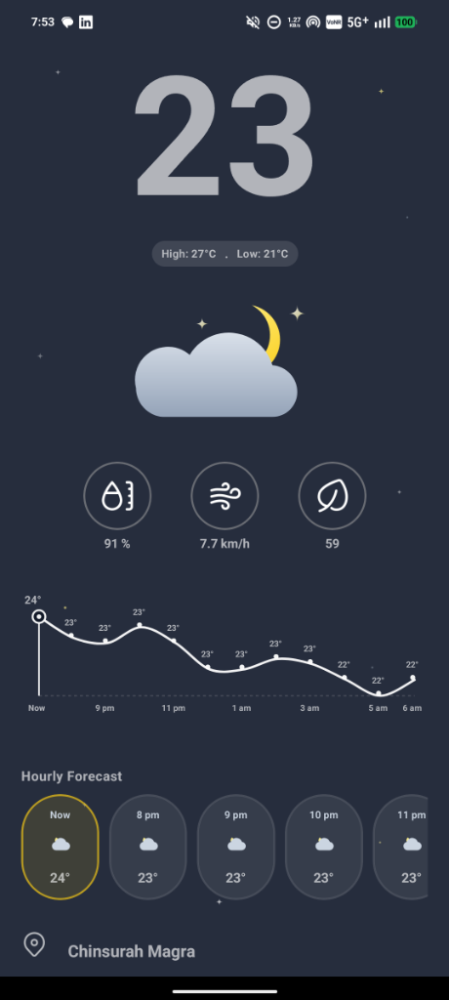
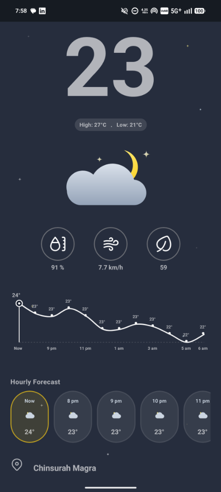

#  Weather App

A modern, minimal, and reactive weather mobile application built with **React Native** and **Expo (SDK 52)**. Features dynamic day/night atmospheric theming, pure SVG vector animations, a smooth cubic Bezier temperature wave graph, real-time air quality index (AQI), hourly forecast, and full edge-to-edge Android system bar synchronization.

---

##  Visual Showcase

<div align="center">
  <table>
    <tr>
      <td align="center">
        <b>Night Theme — Clear / Starry Sky</b><br/><br/>
        
      </td>
      <td align="center">
        <b>Edge-to-Edge Synchronized UI</b><br/><br/>
        
      </td>
    </tr>
  </table>
</div>

---

##  App Demo Video

<!-- 
  You can embed an MP4 video or an animated GIF preview below.
  To host the video directly on GitHub:
  1. Open a GitHub Issue / PR or Release, drag and drop your video file.
  2. Copy the generated video URL and paste it into the src attribute below.
  Alternatively, place your recorded video in 'assets/demo.mp4' or 'assets/demo.gif'.
-->

<div align="center">
  <video width="340" height="auto" controls="true" poster="assets/screenshots/app-screenshot-1.png">
    <source src="assets/demo.mp4" type="video/mp4">
    Your browser does not support the video tag.
  </video>
  <p><i>Previewing live animated stars, dynamic weather vector transitions, and hourly wave graph navigation.</i></p>
</div>

> **Tip:** If you have an animated GIF or video recording of the app, replace `assets/demo.mp4` with your file path or embed a direct link from your GitHub releases / repository media.

---

##  Key Features

- ** Adaptive Weather Theming:** Dynamic palette transitions responding to weather codes and day/night cycles (`#111827` clear night, `#262d3d` cloudy night, `#1e293b` rainy night, `#fff0c5` clear day, etc.) with automatic high-contrast typography.
- ** Pure SVG Animated Weather Vectors:**
  - **Sun:** Smooth 360° rotation and radiant breathing pulse animation.
  - **Moon:** Crisp, luminous crescent moon with radial gradient glow.
  - **Animated Stars:** 10 delicately placed pinpoint stars with staggered twinkle animations across clear and cloudy night skies.
  - **Rain Cloud:** Dual-layer cloud with cascading animated raindrops.
  - **Sun/Moon Clouds:** Composite depth vectors with layered weather geometry.
- ** Minimalist Temperature Wave Graph:**
  - Built with Catmull-Rom cubic Bezier curve smoothing for an organic temperature trajectory.
  - Static current-time marker (`⊙ Now`) with vertical indicator stem.
  - Interactive timeline timestamps along the bottom axis.
- ** 12-Hour Forecast Carousel:** Horizontal scrollable forecast cards highlighting the projected temperature, time, and contextual vector icons for each upcoming hour.
- ** Daily High / Low Temperatures:** Instant daily range snapshot (`H: 26° / L: 14°`) directly beneath the current temperature.
- ** Real-Time Weather Metrics & Air Quality:**
  - Wind Speed (km/h)
  - Relative Humidity (%)
  - US Air Quality Index (US AQI) fetched in real-time
- ** Precise Geolocation & Reverse Geocoding:** Automatically captures GPS coordinates and converts them into human-readable city/locality names via BigDataCloud.
- ** Edge-to-Edge System Bar Integration:** Fully synchronized Android Navigation Bar and Status Bar that match the dynamic app background color with no visual seams.

---

##  Tech Stack & Libraries

| Technology | Purpose |
|---|---|
| **[React Native](https://reactnative.dev/)** (0.76.9) | Cross-platform mobile development framework |
| **[Expo](https://expo.dev/)** (SDK 52) | Tooling, build pipeline, and developer workflow |
| **[Open-Meteo](https://open-meteo.com/)** | Free, open-source weather and air quality APIs |
| **[BigDataCloud](https://www.bigdatacloud.com/)** | Reverse geocoding client for location names |
| **[react-native-svg](https://github.com/software-mansion/react-native-svg)** | Native SVG rendering engine for weather vectors |
| **[expo-location](https://docs.expo.dev/versions/latest/sdk/location/)** | High-accuracy foreground GPS coordinates |
| **[expo-navigation-bar](https://docs.expo.dev/versions/latest/sdk/navigation-bar/)** | Android native navigation bar styling & theming |
| **[expo-status-bar](https://docs.expo.dev/versions/latest/sdk/status-bar/)** | Contextual light/dark status bar styling |

---

##  Project Structure

```text
Weather/
├── assets/                       # Static app icons, splash, & screenshots
│   ├── icon.png
│   ├── splash-icon.png
│   ├── screenshots/              # README screenshots & media
│   │   ├── app-screenshot-1.png
│   │   └── app-screenshot-2.png
│   └── ...
├── src/
│   └── components/
│       ├── GraphDiagram/         # Catmull-Rom cubic Bezier temperature graph
│       │   └── GraphDiagram.js
│       ├── RainCloud/            # Animated rain cloud & falling drops
│       │   └── RainCloud.js
│       ├── houarly/              # 12-hour horizontal forecast cards
│       │   └── Hour.js
│       ├── info/                 # Wind, Humidity, and AQI metrics cards
│       │   ├── Aqi.js
│       │   ├── Humidity.js
│       │   ├── Info.js
│       │   └── Wind.js
│       ├── place/                # Geocoded city & locality component
│       │   └── Place.js
│       ├── tempe/                # Temperature display & High/Low range
│       │   ├── HighLow.js
│       │   ├── TempSection.js
│       │   └── TempText.js
│       └── vectors/              # Vector illustrations & animations
│           ├── AnimatedStars.js
│           ├── Cloud.js
│           ├── Moon.js
│           ├── MoonCloud.js
│           ├── RainDrop.js
│           ├── Sun.js
│           └── SunCloud.js
├── App.js                        # Core application state, API calls & theming
├── app.json                      # Expo application manifest & configuration
├── package.json                  # Dependencies & scripts
└── README.md
```

---

## Getting Started

### Prerequisites

- [Node.js](https://nodejs.org/) (v18 or higher recommended)
- [npm](https://www.npmjs.com/) or [bun](https://bun.sh/)
- [Expo Go](https://expo.dev/go) app installed on your physical device (iOS/Android), or an Android Emulator / iOS Simulator.

### 1. Clone the Repository

```bash
git clone https://github.com/your-username/Weather.git
cd Weather
```

### 2. Install Dependencies

```bash
npm install
```

### 3. Start the Development Server

```bash
npx expo start
```

### 4. Run on a Device or Simulator

- **Android Device / Emulator:** Press `a` in the terminal or run `npm run android`
- **iOS Simulator:** Press `i` in the terminal or run `npm run ios`
- **Expo Go:** Scan the QR code displayed in the terminal using the Expo Go app (Android) or Camera app (iOS).

---

## APIs Used

1. **Weather Forecast API:**
   ```http
   GET https://api.open-meteo.com/v1/forecast?latitude={lat}&longitude={lon}&current=temperature_2m,relative_humidity_2m,is_day,weather_code,wind_speed_10m&hourly=temperature_2m,weather_code,is_day&daily=temperature_2m_max,temperature_2m_min&forecast_hours=12&timezone=auto
   ```
2. **Air Quality API:**
   ```http
   GET https://air-quality-api.open-meteo.com/v1/air-quality?latitude={lat}&longitude={lon}&current=us_aqi
   ```
3. **Reverse Geocoding API:**
   ```http
   GET https://api.bigdatacloud.net/data/reverse-geocode-client?latitude={lat}&longitude={lon}&localityLanguage=en
   ```

---

## License

This project is open-source and available under the terms of the [MIT License](LICENSE).
